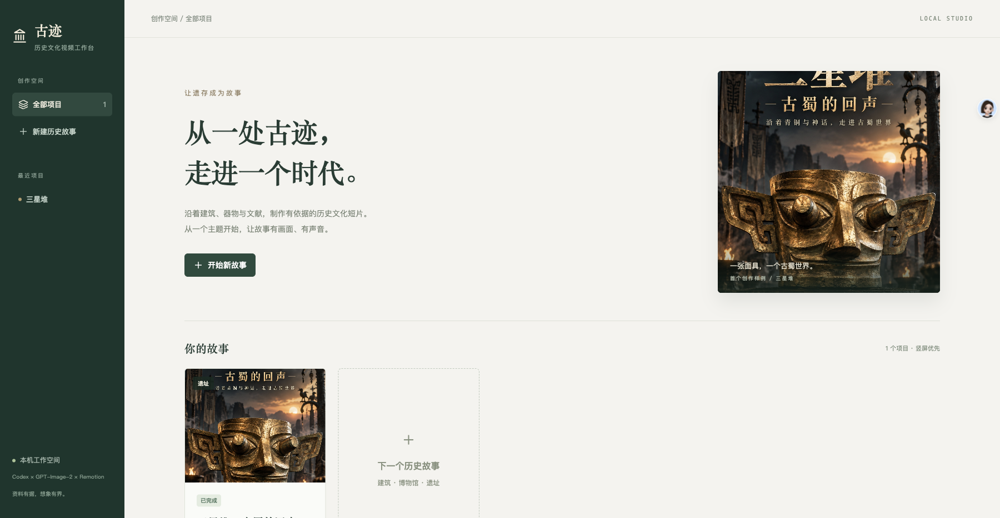

# 古迹 · 历史文化视频工作台

本机网页工具：以历史建筑、博物馆或遗址为主题，生成有资料依据的历史故事短片。使用 Codex 研究与编剧、GPT-Image-2 场景和封面、Mac 中文旁白、Remotion 合成。默认 9:16、1080×1920、30fps、60至90秒，目标72秒。



## 启动

```sh
git clone https://github.com/liuqing0224/history-video-workbench.git
cd history-video-workbench
./start.command
```

macOS 双击 `start.command`，或在本目录运行 `./start.command`。页面地址 http://127.0.0.1:4317 。已有服务时直接打开页面，不启动第二个实例。

开发：`npm run dev`。生产模式：`npm run build` 后 `npm start`。验证：`npm test`、`npm run check`。

依赖：Node.js 22+、Python3（样例导入）、Codex CLI、已配置的 `~/.local/bin/imagegen-cli`、ffmpeg/ffprobe、macOS `say -v Tingting`。Remotion 固定4.0.534；首次渲染自动下载对应Chrome Headless Shell。安装锁定在package-lock.json。图像与研究调用读取本地已有配置；不把认证配置复制进项目或传给浏览器。环境变量 `HISTORY_IMAGEGEN_CLI` 可指定图像CLI路径，`PORT` 可改端口，`HISTORY_DATA_DIR` 可改数据根目录，`HISTORY_CHROME_PATH` 可指定兼容Chrome。

## 使用

1. 创建主题，选择建筑、博物馆或遗址，可补充官网、讲述重点和参考照片。点击“创建并制作”启动完整流程；“仅创建”可先整理输入。
2. 在“内容与依据”查看资料、事实、传说与艺术想象。修改主题/重点/官网后再次一键制作，会重新研究；“重新检索”明确替换当前脚本，历史版本保留。
3. 在“分镜与素材”修改旁白、提示词、镜头顺序、最短时长和引用；可以替换图片、重做单张图或单段旁白。横图选择“完整保留主体”，竖图选择“铺满竖屏”，可调水平焦点。
4. 在“成片与封面”预览时间线、重新合成、下载MP4和JPEG、查看旧成片与旧封面。重新合成会补齐因编辑失效的画面和旁白，不重新生成未变化素材。重做单镜也自动合成成片；封面重做独立执行。

网页输入不是任意Shell命令。任务由服务端参数数组调用本机工具，单队列串行运行；图像请求串行。生成图片和Codex研究会使用已有服务额度。来源不足、名称歧义、时长超出60至90秒或缺少素材时停止并显示具体原因；用户补充资料或缩短旁白后手动继续。

## 项目资产

`data/projects/<id>/project.json` 是唯一当前数据源，schemaVersion=1。assets保存图片、每句旁白、参考照片和封面；docs保留样例资料；versions保存编辑与生成前快照；outputs保存成片与媒体检查报告。jobs记录任务状态。所有生成提示词与实际图像尺寸都保留。数据目录不提交Git，完整项目备份必须包含data；不要只备份源码。

`examples/sanxingdui` 随仓库提供九幅原始采用图像、后续竖屏面具、逐句旁白、环境声、提示词、来源和竖屏封面。原始素材为横屏，样例已适配竖屏时间线；无需调用图像服务就能重新合成。导入命令 `npm run import:sample` 不覆盖已有样例。运行产生的成片、历史版本及个人项目保存在忽略的 `data` 目录中，不随Git上传。

## 边界

仅本机、单用户；不包含文章生成、公众号发布或账号管理。AI图像是关键帧，不是连续动作视频；背景和人物重建需要艺术想象标注。研究提示词要求实际检索和证据摘要，但模型结果仍需人工核对，尤其文物结构和历史判断。新题材的生产质量不由三星堆样例自动证明。

实现说明见 `docs/制作流程.md`；当前交付与验证范围见 `docs/项目状态.md` 和 `qa/验收记录.md`。
